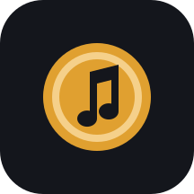

<p align="center">
  
</p>

<h1 align="center">Begood Music Player (B.M.P)</h1>

<p align="center">
  O player para as músicas que estão <b>no seu celular</b>. App Android gratuito, sem anúncios e de código aberto:<br>
  letras sincronizadas, equalizador paramétrico, editor de tags com capas, playlists "Genius", modo estudo e tudo funcionando no carro.
</p>

<p align="center">
  <a href="https://github.com/robertobegood-jpg/Begood-Music-Player-app-Android/releases/latest"><b>⬇️ Baixar o APK</b></a> ·
  <a href="#-instalação-fora-da-play-store"><b>📲 Como instalar</b></a> ·
  <a href="#-cafezinho-para-o-dev"><b>☕ Apoiar o projeto</b></a> ·
  <a href="https://github.com/robertobegood-jpg/Begood-Music-Player-app-Android/issues"><b>💬 Sugestões e problemas</b></a>
</p>

---

## Por que usar

Quem ainda guarda a própria coleção de músicas (MP3, FLAC, M4A...) merece um player à altura. O B.M.P lê os
arquivos do celular, organiza por álbum e artista do jeito certo, mostra a letra enquanto a música toca e
soa bem em qualquer saída — alto-falante, fone, caixa Bluetooth ou o som do carro.

## Funções

**Abas:** Álbuns • Artistas • Músicas • Gêneros • Playlists • Buscar

### 🎵 Biblioteca
- Você escolhe as **pastas** que entram (sem escolher nenhuma, usa a pasta **Music** da memória e do cartão SD).
- **Artistas** separados por "artista do álbum" e "artista da faixa": participações ("feat.") aparecem nos dois.
- **Toque longo** marca várias músicas para tocar, pôr na fila ou editar de uma vez.

### 🎤 Letras
- Procura nas tags da música, em arquivo `.lrc`/`.txt` com o mesmo nome e, se não achar, no **LRCLIB** (gratuito, com letra **sincronizada**).
- Também dá para pesquisar no Google, colar a letra e **gravar na música** (uma a uma ou todas de uma vez).

### 🎚️ Equalizador paramétrico
- Até **10 bandas** com frequência, ganho e largura livres, pré-amplificação automática e presets prontos ou seus.
- Funciona no alto-falante, no fone **e no Bluetooth** (é feito pelo próprio app, não depende do celular).

### 🏷️ Editor de tags
- Edite uma música, o álbum inteiro ou várias de uma vez: artista, álbum, ano, gênero, letra e **capa**.
- **Atualizar pela internet**: busca no iTunes e no Deezer e preenche dados, número das faixas e capa em alta resolução.

### 📋 Playlists
- **Suas playlists**, montadas pelo menu de cada música, do álbum ou salvando a fila.
- **Automáticas**: Favoritas, Mais tocadas, Tocadas recentemente e Adicionadas recentemente.
- **Importar e exportar `.m3u`**, inclusive playlists feitas no PC (o app acha a música mesmo com caminhos do Windows).
- **Genius**: escolha uma música e o app monta uma playlist de 25 a 100 músicas que combinam com ela, como no iPod.
  Usa a Last.fm e guarda os dados no celular para funcionar **sem internet**. Sem chave da Last.fm, combina pelo gênero e pela época.

### 🎸 Modo estudo
- **Velocidade** sem mudar o tom, **tom** acima ou abaixo e **repetir um trecho A/B** — ótimo para tirar música.

### 🚗 Bluetooth e carro
- Controles do fone e do carro, título e capa no visor, pausa ao desconectar.
- Navegue por álbuns, artistas e playlists pelo **Android Auto** ou pela central do carro.
- O botão play do carro **retoma a última fila** mesmo com o app fechado; opção de voltar a tocar sozinho ao conectar.

---

## 📲 Instalação (fora da Play Store)

O app não está na Play Store: ele é instalado direto pelo arquivo **APK**, que fica aqui no GitHub. É seguro e leva um minuto.

1. **No celular**, abra a página da [última versão](https://github.com/robertobegood-jpg/Begood-Music-Player-app-Android/releases/latest)
   e toque no arquivo **`BegoodMusicPlayer-vX.Y.Z.apk`** (em *Assets*) para baixar.
2. Quando o download terminar, toque em **Abrir** (ou abra o arquivo na pasta **Downloads**).
3. O Android vai avisar que não pode instalar apps desta fonte. Toque em **Configurações** e ative
   **"Permitir desta fonte"** para o navegador (Chrome) ou o gerenciador de arquivos. Volte e toque em **Instalar**.
4. Se aparecer o **Play Protect** dizendo que o app é desconhecido, toque em **Mais detalhes › Instalar mesmo assim**.
   Esse aviso aparece para qualquer app de fora da loja; o código está todo aqui para quem quiser conferir.
5. Abra o app e toque em **Permitir** (acesso às músicas e às notificações).

> Requer **Android 8.0** ou superior.

<details>
<summary>Onde fica a opção "instalar apps desconhecidos" em cada marca</summary>

- **Samsung:** *Configurações › Aplicativos › (menu ⋮) Acesso especial › Instalar aplicativos desconhecidos*.
- **Xiaomi / Redmi / Poco:** *Configurações › Privacidade (ou Proteção) › Fontes desconhecidas*.
- **Motorola e Android puro:** *Configurações › Apps › Acesso especial a apps › Instalar apps desconhecidos*.

Escolha o app usado para abrir o APK (Chrome, Arquivos...) e ative **Permitir desta fonte**. Depois de instalar, pode desativar de novo.
</details>

### Atualizar
Baixe o APK da versão nova e instale **por cima**. As playlists, favoritas e ajustes continuam.

> 💡 Para ser avisado das versões novas, use o [Obtainium](https://github.com/ImranR98/Obtainium) (gratuito e de código aberto):
> toque em *Adicionar app*, cole o endereço deste repositório e ele avisa e instala as atualizações sozinho.

### Primeiros passos
1. Em **⚙ Configurações**, adicione as pastas onde estão suas músicas (ou deixe a pasta padrão **Music**).
2. Toque em **Escanear agora** sempre que colocar músicas novas no celular.
3. Para o **Genius**, crie uma chave grátis da Last.fm pelo botão em *Configurações › Genius* e toque em **Baixar para usar offline**.
4. Se a música parar com a tela apagada: *Configurações do Android › Apps › B.M.P › Bateria → Sem restrições*.

---

## Privacidade

- **Sem cadastro, sem anúncios e sem servidor próprio.** Suas músicas, playlists e estatísticas ficam só no celular.
- A internet é usada **só** para buscar letras (LRCLIB), dados e capas de álbuns (iTunes e Deezer) e músicas parecidas (Last.fm),
  e apenas com o nome do artista, do álbum ou da música. Nenhum arquivo seu é enviado.
- A chave da Last.fm fica guardada no próprio celular.

### Permissões
| Permissão | Para quê |
|---|---|
| Músicas e áudio | Ler as músicas do celular (e gravar tags e letras quando você pedir) |
| Notificações | Mostrar a música tocando, com os controles |
| Internet | Letras, capas, dados de álbuns e Genius |
| Tocar em segundo plano | Continuar tocando com a tela apagada e no carro |

---

## ☕ Cafezinho para o Dev

O app é gratuito e sem anúncios. Se ele faz parte do seu dia, pode apoiar o desenvolvimento com um Pix de qualquer valor.
Também dá para fazer isso direto no app, em **⚙ Configurações › Pague um cafezinho**, com QR Code.

- **Chave Pix (e-mail):** `robertobegood+itau@gmail.com`
- **Nome:** Roberto Santos da Silva

**Pix copia e cola** (valor livre):
```
00020126630014br.gov.bcb.pix0128robertobegood+itau@gmail.com0209Cafezinho5204000053039865802BR5923Roberto Santos da Silva6009Sao Paulo62070503***63047463
```

Obrigado! 💛

---

## Para desenvolvedores

Kotlin + Jetpack Compose, reprodução com Media3/ExoPlayer, tags com JAudioTagger e QR Code com ZXing. Pacote `br.com.begood.bmp`.

```
app/src/main/java/br/com/begood/bmp/
  player/   serviço de música (MediaLibraryService), equalizador, modo estudo
  data/     biblioteca (MediaStore), tags, letras, playlists, estatísticas, Genius, capas
  ui/       telas em Compose, tema âmbar e cafezinho (Pix)
```

- Equalizador: filtros biquad (Audio EQ Cookbook) num `AudioProcessor` do ExoPlayer (`player/Equalizador.kt`).
- Tags: edita uma cópia e grava de volta via `MediaStore.createWriteRequest` (`data/Tags.kt`).
- Playlists em `files/playlists.json` (guardam o caminho do arquivo); reproduções e favoritas em `files/estatisticas.json`.
- Genius: Last.fm `track.getSimilar` e `artist.getSimilar`, guardados por 90 dias (`data/Genius.kt`); o cálculo fica em `data/GeniusMotor.kt`.
- Capas embutidas: endereço `bmpcapa://` lido pelo Coil e pela notificação (`data/Capas.kt`).

**Compilar:** abra a pasta no Android Studio ou rode `./gradlew assembleDebug`. Sem a chave oficial, o APK sai com a
chave de debug: funciona normalmente, mas não atualiza por cima da versão oficial.

**Publicar uma versão** (mantenedor): suba `versionCode` e `versionName` em `app/build.gradle.kts`, faça o commit e crie
uma tag `vX.Y.Z`. O GitHub Actions compila, assina e publica a Release com o APK.

Sugestões e correções são bem-vindas por [issues](https://github.com/robertobegood-jpg/Begood-Music-Player-app-Android/issues) e pull requests.

## Licença

[GPL-3.0](LICENSE): você pode usar, estudar, modificar e redistribuir, desde que as versões derivadas também sejam abertas sob a mesma licença.

Desenvolvido por Roberto Santos da Silva.
